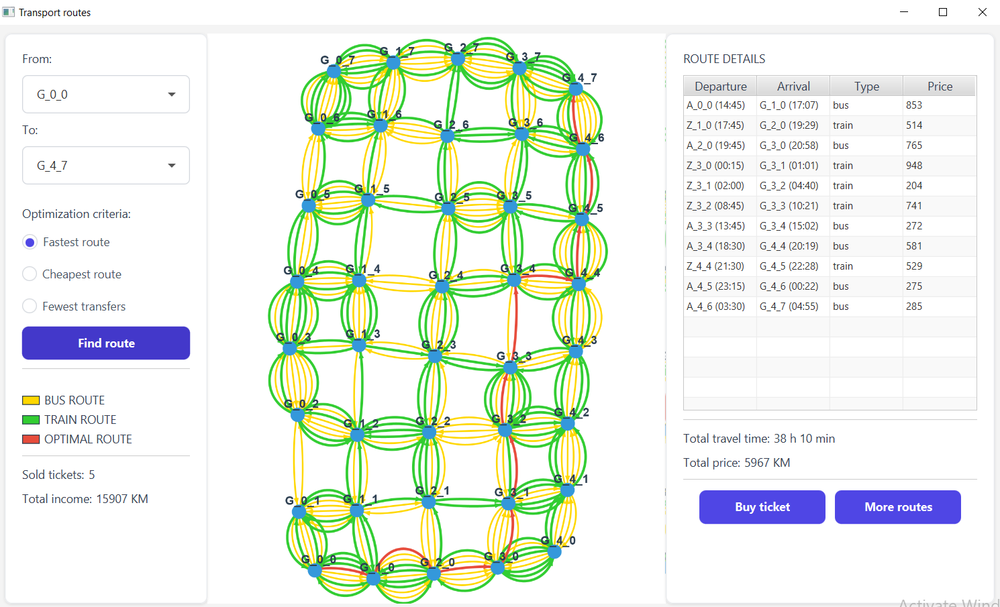
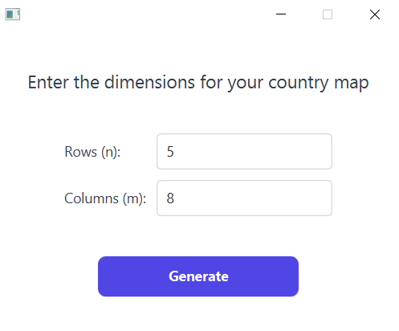
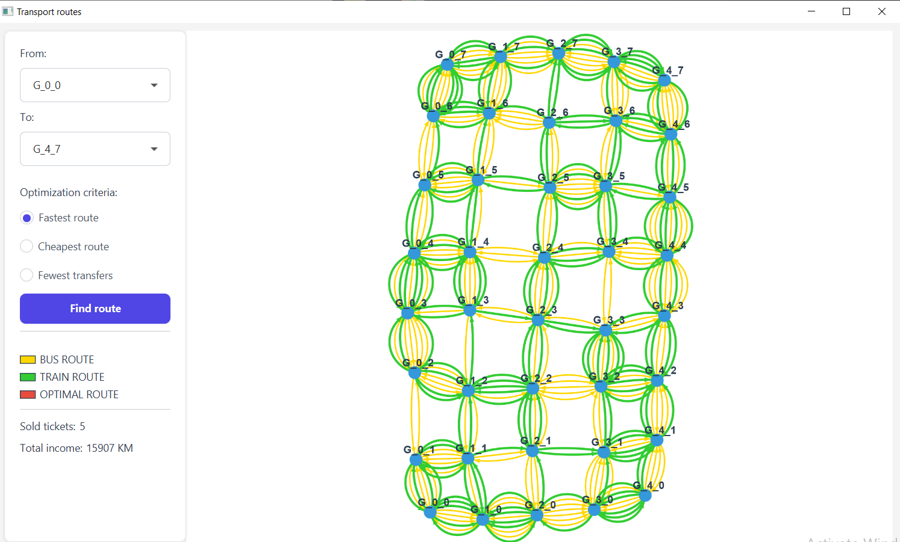
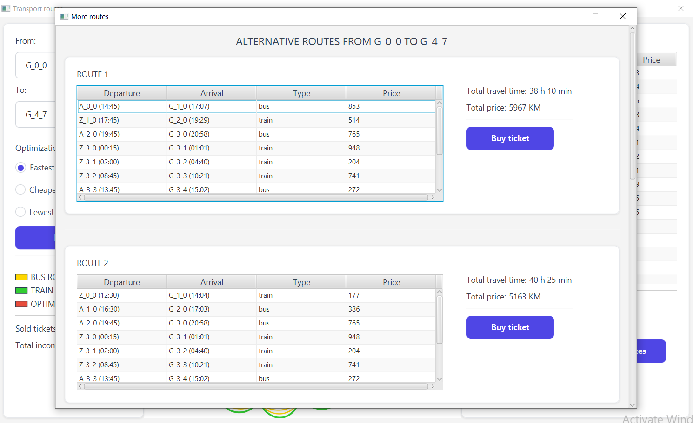
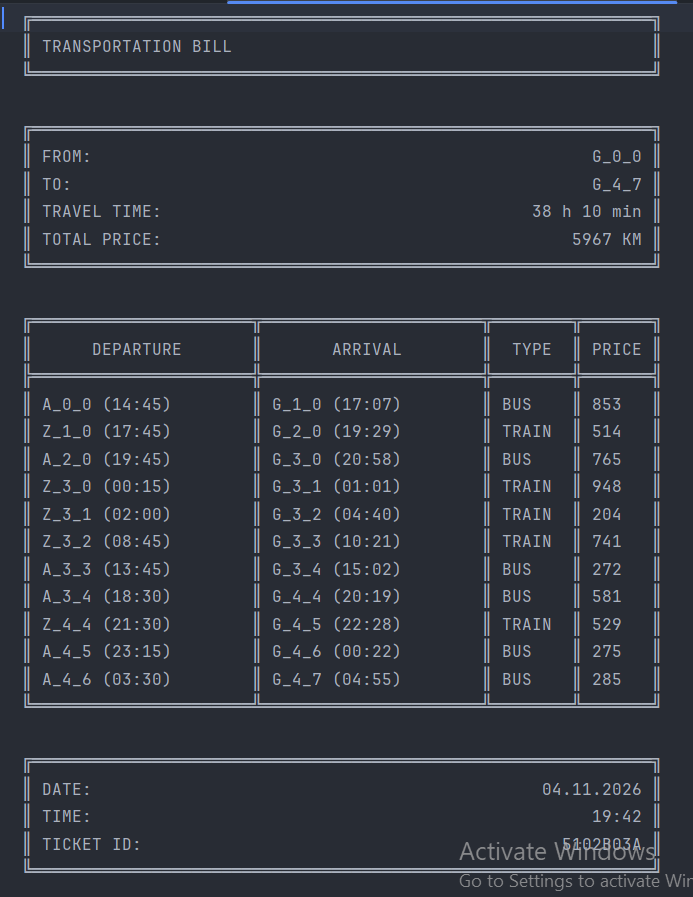

# TransportApp

A JavaFX desktop application for finding the optimal travel route between cities by combining **bus and train transport**. It uses **Dijkstra's algorithm** to find the best route and **Yen's K-shortest paths algorithm** to find the top 5 alternatives.

Built as a university project for the **Programming Languages 2** course (Faculty of Electrical Engineering, University of Banja Luka).



## How it works

The country is modeled as an **n x m matrix of cities**. Every city has a **bus station** and a **train station**, each with its own departure schedule. Every departure has a departure time, an arrival time, a ticket price and a minimum transfer time.

The transport network is represented as a **directed graph**:
- **nodes** are cities (`G_X_Y`), since a city's bus station and train station share the same coordinates
- **edges** are bus and train departures between neighboring cities

A traveler can freely combine buses and trains. When changing to the next departure, the traveler must wait at least the minimum transfer time. If that departure is missed, the traveler takes the same departure on the next day, and the waiting time is included in the total travel time.

## Features

- **Map generation** - the user enters the map dimensions (n x m), and the transport data is generated and saved as JSON
- **Interactive graph visualization** - bus and train connections are color-coded and the optimal route is highlighted (GraphStream)
- **Route optimization by three criteria:**
    - fastest route (shortest total travel time)
    - cheapest route (lowest total price)
    - fewest transfers
- **Route details table** - every leg of the trip with departure, arrival, transport type and price
- **Top 5 alternative routes** for the selected criterion, shown in a separate window
- **Ticket purchase** - buying a route generates a formatted ticket as a text file
- **Sales statistics** - the total number of sold tickets and total income are loaded from previously generated tickets on every startup

## Algorithms

**Dijkstra's algorithm** finds the best path between two cities. The network is a directed graph with non-negative edge weights, which is exactly the case where Dijkstra is guaranteed to find the optimal path. The edge weight depends on the selected criterion: travle time (including waiting), price, or number of transfers.

**Yen's algorithm** finds the K best loopless paths. It builds on Dijkstra by systematically removing parts of already found routes to discover the next best alternatives.


##Tech stack

| Technology      | Purpose                                  |
|-----------------|------------------------------------------|
| Java 17         | Core language                            |
| JavaFX 17       | User interface                           |
| GraphStream 2.0 | Graph visualization                      |
| Jackson         | JSON parsing of generated transport data |
| Maven           | Build and dependency management          |
| Javadoc         | Code documentation                       |

## Screenshots

| Map input                       | Transport network           |
|---------------------------------|-----------------------------|
|  |  |

| Alternative routes                          | Generated ticket                  |
|---------------------------------------------|-----------------------------------|
|  |  |

## Getting started

**Requirements:** JDK 17 or newer. Maven is not required, the project includes the Maven Wrapper.

```bash
git clone https://github.com/ana-spiric/TransportApp.git
cd TransportApp
./mvnw clean javafx:run
```

On Windows use `mvnw.cmd clean javafx:run`.

## Project structure

```
src/main/java/org/example/transportapp/
├── data/   # random data generation and JSON parsing
├── graph/  # transport graph, Dijkstra and Yen algorithms
├── model/  # cities, stations, departures, tickets
├── view/   # JavaFX windows
└── demo/   # application entry point
```

## Acknowledgements

The base version of `TransportDataGenerator` was provided by the course staff. I extended it to support rectangular (n × m) maps, with the dimensions passed through the constructor.

## Author

**Ana Spiric** - Software Engineering student
[GitHub](https://github.com/ana-spiric)